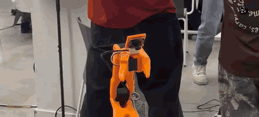
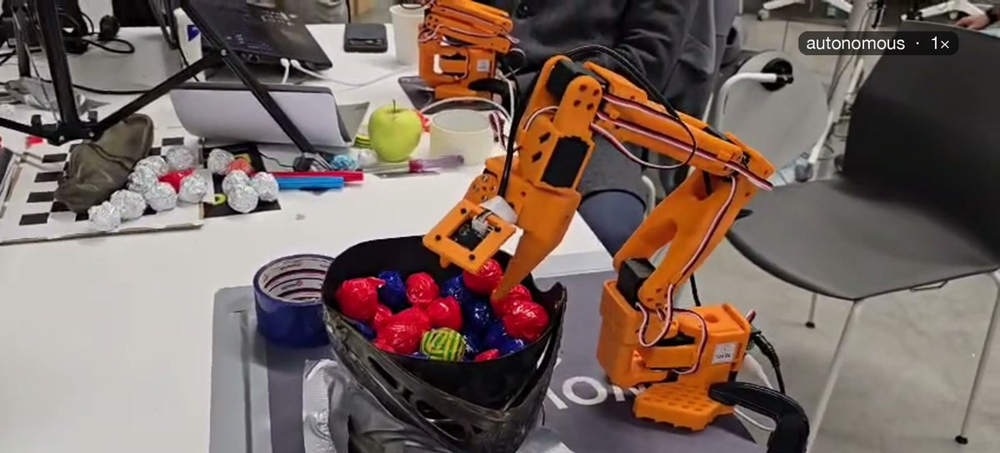
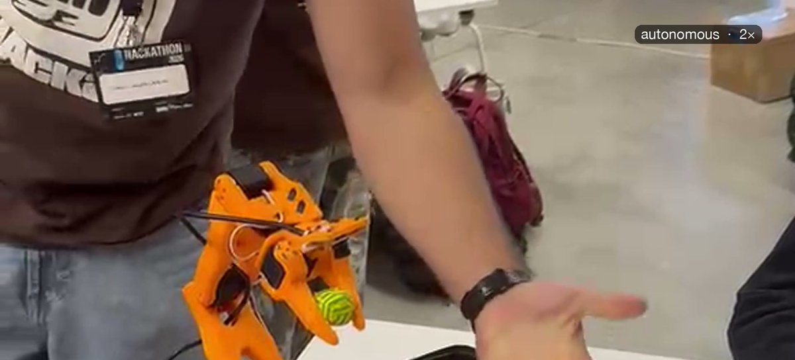
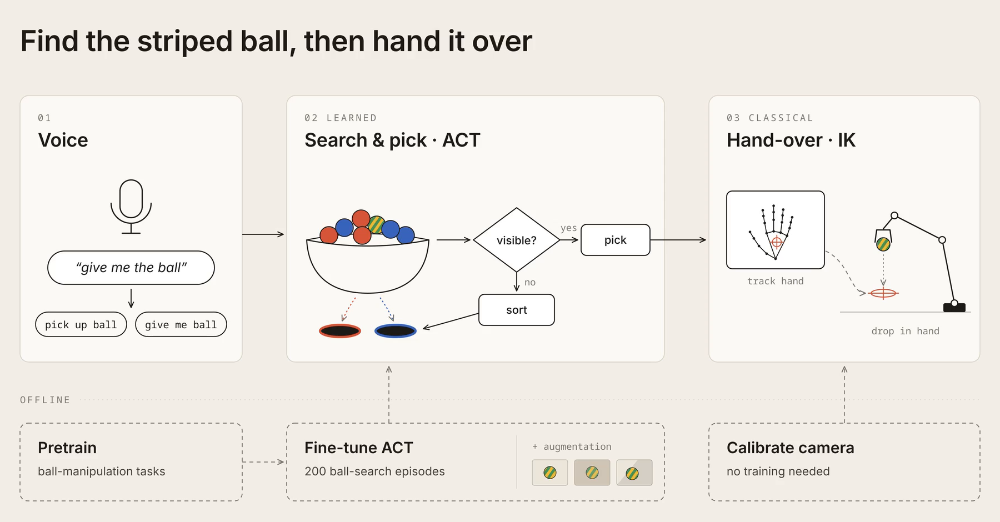
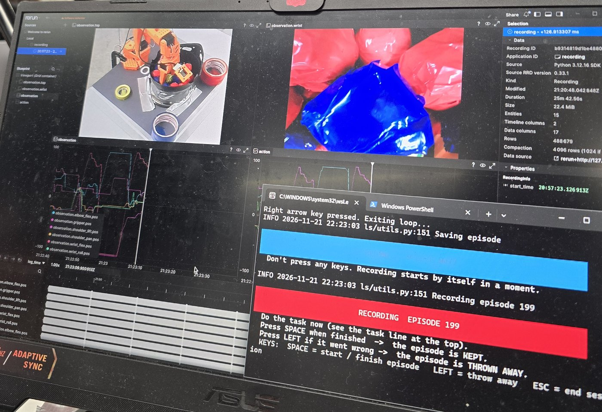
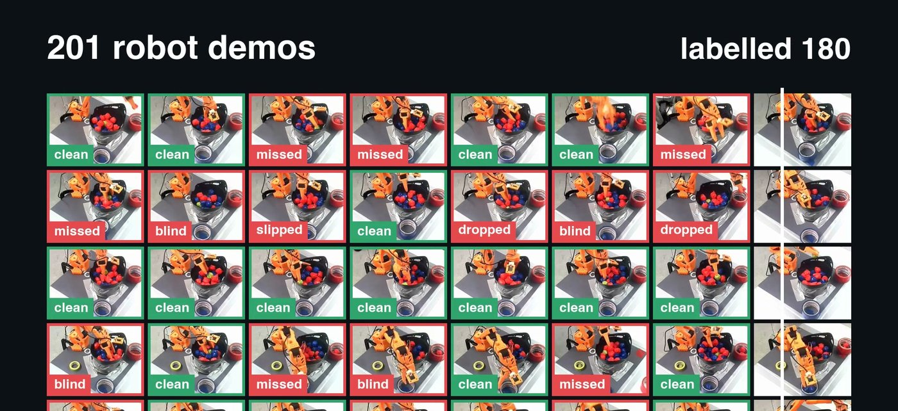
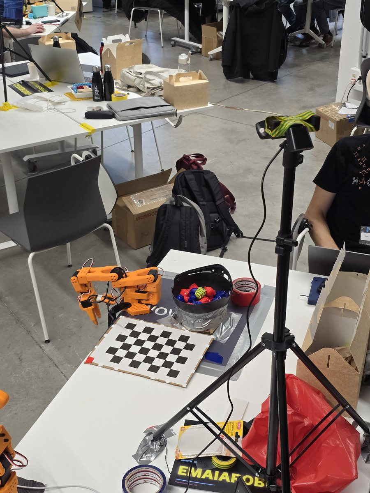
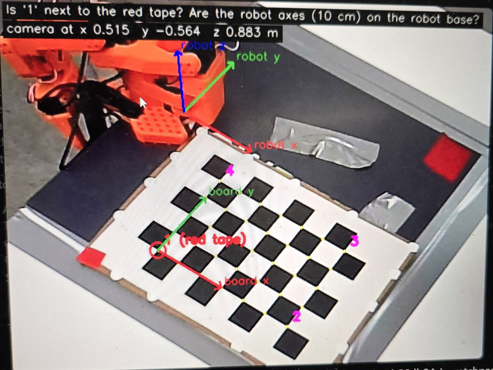
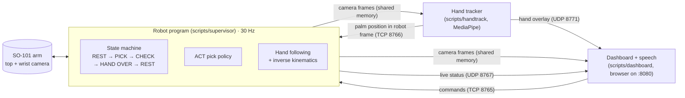
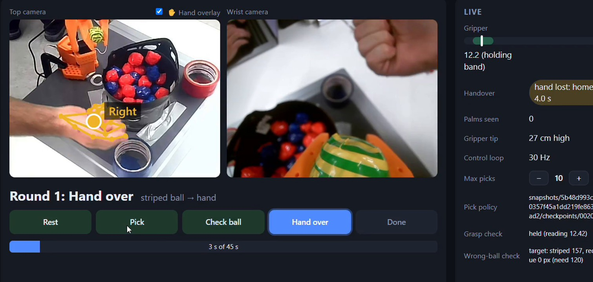

# Find the striped ball, then hand it over

[](LICENSE)
[](https://github.com/huggingface/lerobot)

An SO-101 robot arm that digs a striped ball out of a bowl full of red and blue balls, checks that it has the right one, and drops it into your open hand. You start it by voice ("give me the ball") or from a web dashboard.

Built in 48 hours by a team of five at the [Bilbao Physical AI Hackathon](https://hackathonbilbao.eus/home-page-eus) (20–22 November 2026) with [LeRobot](https://github.com/huggingface/lerobot) 0.7.0, one SO-101 arm, two cameras and a gaming laptop.

<p align="center">
  
  <br><sub>Autonomous run: pick at 1×, hand-over at 2× speed.</sub>
</p>

## What it does

1. **Listen.** Someone says "give me the ball" or clicks a tile on the dashboard. Speech is transcribed on the laptop's CPU.
2. **Search and pick (learned).** An [ACT](https://arxiv.org/abs/2304.13705) policy looks through the top and wrist cameras and goes for the striped ball. If the ball is buried, the policy digs: it pushes red and blue balls aside until it can grasp the target. A grasp check on the gripper detects an empty close and starts a new attempt.
3. **Check (classical).** The wrist camera checks the colours of the held ball. A red or blue ball is put down and the pick runs again.
4. **Hand over (classical).** The top camera tracks an open palm with MediaPipe. The camera calibration maps the palm into the robot's frame, and inverse kinematics keeps the gripper hovering about 8 cm above it. Hold your palm still for 1.5 s and the arm drops the ball into it, snaps its gripper three times to celebrate and folds back to rest.

<p align="center">
  
  
</p>



The dashboard can also make the arm dance (a public SO-101 dance recording, replayed safely) and run spoken multi-step plans such as "take out two blue balls, then give me the striped one". The plans need the per-colour clearing policies, which were trained but did not grasp reliably on the arm. An experimental finger-biting round (point at the gripper and it snaps) is greyed out on the dashboard as "coming soon".

## Results

**Current model: [`TianK003/act_hidden_from_v2`](https://huggingface.co/TianK003/act_hidden_from_v2), checkpoint `002000`, run with `n_action_steps` 30.** It is ACT (51.6M parameters, of which 34M run at inference), trained in two stages:

1. Fine-tuned from a pick policy for the older tinfoil-ball scene on all 201 red/blue demonstrations (`Space0code/act_redblue_from_foil_v2`, 20K steps).
2. Fine-tuned 2K more steps on the 38 clean demonstrations that start with the ball buried or partly covered.

It runs at 30 Hz on an RTX 4050 laptop GPU.

| Pick success on the arm (paired layouts) | `act_hidden_from_v2@002000` | `act_redblue_from_foil_v2@20000` |
| --- | --- | --- |
| 9 layouts, 50 action steps, 90 s cap | **7/9** | 5/9 |
| 4 layouts, 30 action steps, 90 s cap (7-model benchmark) | **4/4** | 3/4 |
| Together | **11/13** | 8/13 |

These samples are small, but the two tests agree: the fine-tuned model won every layout where the two models disagreed. The biggest single gain did not come from training. Executing 25–50 of each predicted 100-step action chunk before replanning, instead of all 100, took v2 from 4/10 to 6/10. Hidden balls remain the hard case.

Every model we trained, every dataset and every benchmark, with how the choices changed over the 48 hours: **[docs/HISTORY.md](docs/HISTORY.md)**.

## Data

<p align="center">
  
  
</p>

We recorded every demonstration by teleoperation with the leader arm at 30 fps, with a top camera and a wrist camera (640×480). Then we labelled each episode (clean, missed grasp, blind, slipped, dropped) in our own curation dashboard and trained on chosen subsets.

| Dataset | Episodes | Frames | Scene and use |
| --- | --- | --- | --- |
| [`molnrb/so101_pick_rb_mixed`](https://huggingface.co/datasets/molnrb/so101_pick_rb_mixed) | 201 | 131,706 | Striped ball among red and blue balls: visible, partly covered or buried. The arm sorts covering balls into the red and blue holes, picks the target and returns to rest. **Every red/blue model, including the current one.** |
| [`molnrb/so101_pick_ball_combined`](https://huggingface.co/datasets/molnrb/so101_pick_ball_combined) | 145 | 91,930 | The first scene: striped ball among grey tinfoil balls, visible (`so101_pick_blue_ball`, 100) and buried (`so101_pick_buried_ball`, 45). Trained the start weights of the red/blue models. |
| [`brouthen/so101_pick_striped_all`](https://huggingface.co/datasets/brouthen/so101_pick_striped_all) | 314 | 180,134 | Tinfoil and red/blue episodes merged with corrected task sentences, for pretraining. |
| [`molnrb/so101_give_hand`](https://huggingface.co/datasets/molnrb/so101_give_hand) | 50 | 18,502 | Dropping the ball into an open palm, for a learned hand-over that we parked in favour of the classical one. |

All are LeRobot v3.0 datasets at 30 fps. The full list, including the pilot recording, the clearing segments and the borrowed dance dataset, is in [docs/HISTORY.md](docs/HISTORY.md#datasets). Browse any of them in the [LeRobot dataset visualizer](https://huggingface.co/spaces/lerobot/visualize_dataset).

## How it is built

<p align="center">
  
  
</p>

**Hardware:** SO-101 follower and leader arms, a top camera on a tripod and a wrist camera. The bowl sits on the table with a red and a blue "hole" (tape rolls) next to it. A checkerboard calibrates the top camera into the robot's frame (right picture: the robot's axes drawn on the camera image).

**Software:** three processes on one laptop. Only the robot program talks to the motors; everything else reads its camera frames from shared memory and talks to it over local sockets. A slow tracker or a closed browser tab can never stall the 30 Hz control loop.



Key design choices. The full reasoning, with the alternatives we tried, is in [`decisions/`](decisions/):

- **A supervisor decides, skills act.** A small state machine chains short skills on a single robot connection. It never resets or reconnects while the arm holds the ball. ([supervisor](decisions/supervisor.md), [skill policies](decisions/skill-policies.md))
- **Learned where it has to be, classical where it can be.** Digging for a hidden ball is learned. The hand-over is geometry: a calibrated camera, a tracked palm and inverse kinematics, with speed limits and a height floor. ([hand-following geometry](decisions/hand-following-geometry.md), [safety](decisions/hand-following-safety.md))
- **ACT, not a VLA.** pi0.5 ran out of memory on our 8 GB laptop GPU. A SmolVLA fine-tune picked 0 of 4 in the final benchmark. ([skill policies](decisions/skill-policies.md), [hidden-ball picking](decisions/hidden-ball-picking.md))
- **The gripper torque is capped at 200 of 1000.** LeRobot's default of 500 stripped the gripper servo's gears during the hackathon. ([kb/gripper-torque-limit.md](kb/gripper-torque-limit.md))

### Dashboard



The dashboard (`scripts/dashboard/`) starts rounds, shows both cameras with the tracked hand drawn on the top camera, and follows each round state by state. Its live panel shows the gripper, the grasp and wrong-ball checks and the control-loop rate. It records a video of every round, takes voice commands through the browser's microphone, and can also run a teleoperated recording session.

## Quick start

You need [uv](https://docs.astral.sh/uv/) and ffmpeg. torch comes from the CUDA 12.8 wheel index (`pyproject.toml`), so the lock file covers Linux and Windows.

```bash
git clone https://github.com/jakobnunnendorf/lerobot-hackathon.git
cd lerobot-hackathon
uv sync
uv run python tests/cuda.py            # torch build, CUDA, a GPU matmul
uv run python tests/lerobot_check.py   # builds ACT, one train step and one inference step, prints PASS
```

Try the dashboard without an arm, using a stand-in robot program that runs scripted rounds (dashboard environment: `scripts/dashboard/requirements.txt`):

```bash
python scripts/dashboard/fake_robot.py --speed 2    # terminal 1
python scripts/dashboard/server.py --no-speech      # terminal 2, then open http://localhost:8080
```

Run the real demo on the arm (setup first: [docs/setup.md](docs/setup.md), then [docs/demo.md](docs/demo.md)):

```bash
PICK_POLICY=TianK003/act_hidden_from_v2 bash scripts/supervisor/demo_chain.sh --step 002000
```

`demo_chain.sh` runs the pick policy with 30 action steps by default.

## Repository layout

| Path | What is in it |
| --- | --- |
| `scripts/supervisor/` | The robot program: state machine, skills, grasp check, the demo launcher `demo_chain.sh` |
| `scripts/dashboard/` | Web dashboard, speech-to-text, round videos, a fake robot program for testing |
| `scripts/handtrack/`, `scripts/handover/` | MediaPipe hand tracker; kinematics and the hand-following loop |
| `scripts/calib/` | Top camera calibration (intrinsics, camera-to-robot pose, independent cross-check) |
| `scripts/so101/`, `scripts/collect/` | Teleoperation, recording, dataset checks and upload, gripper torque cap, USB fixes |
| `scripts/curation/` | Curation dashboard: browse, label and mix episodes for training |
| `scripts/eval/` | `eval_pick`: compare pick policies on the arm over the same layouts |
| `scripts/modal_train.py`, `scripts/modal_v2_finetune.py` | Cost-capped training recipes on [Modal](https://modal.com); the second one trained the current model |
| `scripts/vision/`, `scripts/voice/`, `scripts/recolour/`, `scripts/analysis/` | Colour detector, voice commands, dataset recolouring, offline data analysis |
| `tests/` | Standalone smoke and scenario tests (`uv run python tests/<file>.py`) |
| `docs/` | Runbooks and [HISTORY.md](docs/HISTORY.md) |
| `decisions/` | Why things are the way they are, and what we tried that did not work |
| `kb/` | Verified facts about the hardware and our models |
| `research/` | External research with sources, and our own data analyses |
| `logs/training/` | Loss curves of the main training runs |

## Documentation

- [docs/](docs/README.md): runbooks for setup, the demo, recording, curation, training, evaluation, calibration and hand tracking.
- [docs/HISTORY.md](docs/HISTORY.md): how the project evolved, every model and dataset, benchmark results.
- [decisions/](decisions/README.md): one record per design question, with the alternatives and their results.
- [kb/](kb/README.md) and [research/](research/README.md): verified facts and background research.

## Team

[Tian](https://github.com/TianK003), [Jakob](https://github.com/jakobnunnendorf), [Tomi](https://github.com/Space0code), [Balazs](https://github.com/molnrb) and [Kamel](https://github.com/BrouthenKamel).

## Thanks

[LeRobot](https://github.com/huggingface/lerobot) and the SO-101 by [TheRobotStudio](https://github.com/TheRobotStudio/SO-ARM100), [MediaPipe](https://ai.google.dev/edge/mediapipe) hand landmarks, [Parakeet](https://huggingface.co/nvidia/parakeet-tdt-0.6b-v2) via [onnx-asr](https://github.com/istupakov/onnx-asr) for speech, the [`NikeSong/so101_gestures_dance`](https://huggingface.co/datasets/NikeSong/so101_gestures_dance) recording for the dance, [Modal](https://modal.com) and Hugging Face for training compute, and the organisers of the Bilbao Physical AI Hackathon.

## License

The code, documentation and images in this repository are licensed under [CC BY-NC 4.0](LICENSE). You may use, share and adapt them for non-commercial purposes if you credit us, link to the licence and say what you changed. Commercial use, including selling the work or a product built on it, is not allowed. A credit line could read: *"Find the striped ball" by Tian, Jakob, Tomi, Balazs and Kamel (github.com/jakobnunnendorf/lerobot-hackathon), CC BY-NC 4.0.*

Dependencies such as LeRobot and MediaPipe keep their own licences. Datasets and models on the Hugging Face Hub carry the licence shown on their Hub pages.
