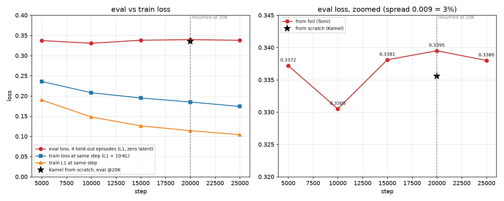

# Project history: models, datasets and what we learned

This is how the project changed over the Bilbao Physical AI Hackathon (2026-11-20 16:00 to 2026-11-22 11:00). It lists every model and dataset we trained or tried. The team was Tian, Jakob, Tomi, Balazs and Kamel. We had one SO-101 arm (LeRobot 0.7.0) with a top camera and a wrist camera.

Times are local (CET). Most facts come from the team's message board (GitHub issue #1), the git history and the public Hugging Face API. Arm results are small samples, counted by hand at the table. Read the caveats in [Benchmarks on the arm](#benchmarks-on-the-arm) before you compare numbers.

**Current PICK model:** [`TianK003/act_hidden_from_v2`](https://huggingface.co/TianK003/act_hidden_from_v2), checkpoint `002000`, run with `n_action_steps` 25. On the arm it was tested at 50 and 30 action steps. It has never been benchmarked at 25. The fallback is [`Space0code/act_redblue_from_foil_v2`](https://huggingface.co/Space0code/act_redblue_from_foil_v2) at checkpoint `20000`.

## Timeline

### Friday 2026-11-20

- **16:00** The hackathon starts. A placeholder idea, bomb defusal, is written up, and supervised cable cutting is added as a second candidate (about 20:20).
- **20:10** The organisers tell us the solution must use at least two cameras and run inference on our own laptops.
- **20:45** First recording on the arm: `molnrb/so101_pick_ball`, 49 episodes of a tinfoil ball being put into a box.
- **23:00** The team drops bomb defusal and cable cutting and switches to **ball picking and handover**. A bowl holds a target ball among tinfoil balls. The arm digs the target out, picks it, and gives it to a hand or puts it down.
- **23:20** Kamel tests pi0.5 (`lerobot/pi05_base`) on his 8 GB RTX 4070 laptop. It runs out of GPU memory while the model is built (about 14 GB in float32). So **every learned skill becomes its own ACT policy**, trained in the cloud and run on a laptop.
- **23:20** The target ball changes from a blue ball to a **yellow and green striped ball**. The early dataset names still say "blue ball", but the striped ball is in them.
- **23:25** Stirring the bowl (a MIX skill) is dropped because the bowl has no room for it. It is replaced by CLEAR: take one grey ball out, drop it in a hole, look again.
- **Night** Balazs records `so101_pick_blue_ball` (100 episodes, target visible) and `so101_pick_buried_ball` (45 episodes, target under tinfoil balls). Kamel trains `act_pick_blue_ball` on his laptop overnight.

### Saturday 2026-11-21

- **Morning** `molnrb/act_pick_ball_combined` is trained on HF Jobs, on 145 visible plus buried foil episodes, and is done at 11:25. On the arm it picks **9 of 10 when the target is visible and 0 to 1 of 10 when it is buried**.
- **11:00** The voice program is merged. Its "hey bot" wake phrase is dropped at 13:20 as unreliable.
- **11:00 to 12:40** The handover plan changes: the arm should follow a hand. A learned approach (ACT or SmolVLA on 50 handover episodes, `molnrb/so101_give_hand`) and a classical one (MediaPipe hand tracking, a calibrated camera and inverse kinematics) are built in parallel.
- **About 12:40** The **tinfoil balls are replaced by 11 red and 11 blue balls**, with a red hole and a blue hole for sorting. The foil glittered in the cameras, and buried picks failed. Jakob's offline analysis later found the buried failures were mostly a long-task problem, not glare. Recording of `molnrb/so101_pick_rb_mixed` starts, with 80 episodes by 14:00.
- **14:15** Tomi decides the demo must handle a deeply buried target too.
- **14:40 to 15:25** Three red/blue policies start training on Modal. Kamel's ACT is trained from scratch, Tomi's ACT is fine-tuned from the foil policy, and Jakob's is a SmolVLA.
- **15:30** The top camera is calibrated. At **16:10 the arm follows a real hand** with the classical loop.
- **16:17** The demo path is fixed: **learned PICK, then rule-based GIVE into a tracked hand, then rest**. The learned handover policy is parked.
- **17:10** First head-to-head on the arm: Tomi's from-foil ACT picks **10 of 13** layouts, Kamel's from-scratch ACT picks 5 of 13. From-foil becomes the demo PICK.
- **17:35** First full demo chain on the arm, through the supervisor. One striped ball is handed over. Three of the six balls it held were red or blue, so a **wrist-camera colour check** (striped pixels in the jaws) is added before the handover.
- **19:00 to 19:40** SmolVLA is tried on the arm through the demo chain. It aims at the striped ball but sometimes closes on its neighbour.
- **Evening** The browser dashboard is built (tiles, voice, live cameras, a video of every round), then recording from the dashboard and a curation and labelling dashboard. `so101_pick_rb_mixed` grows to 120 episodes (20:20), then 152 (21:10). Jakob hand-labels episodes 0 to 57, and Tomi's agents pre-label the rest.
- **21:00** Feature freeze.
- **22:40** For spoken multi-step plans ("two blue, then the striped ball"), Tomi chooses one clearing ACT per colour.
- **23:00 to 00:00** A borrowed SO-101 dance is replayed on the arm. It ran twice without an abort.

### Sunday 2026-11-22

- **00:40** `so101_pick_rb_mixed` is complete at **201 episodes**. Jakob curates 103 clean episodes from it (93 for training, 10 held out) and trains two ACTs on them.
- **01:35** The clearing ACTs `act_clear_red` and `act_clear_blue` are trained. On the arm at **02:10 every close was empty**, and no ball was moved. The multi-step plan stays out of the demo.
- **02:35** Tomi's v2 models are trained on all 201 episodes: one fine-tuned from foil, one from scratch.
- **03:15** A partial five-model screen runs: 12 runs, visible layouts only. Balazs's verdict is "all five are decent".
- **Night** The **follower gripper servo strips its gears**. LeRobot's default torque limit of 500, together with our grasp check squeezing to goal 1, stalled the gripper on every grasp. The servo is replaced and the **torque is capped at 200** (merged 05:15). Arm results from before and after the swap are not comparable.
- **05:35** v1 against v2 on the new servo: v2 picks 6 of 8 with no wrong ball, v1 picks 5 of 8 with one wrong ball. v2 becomes the demo PICK.
- **06:35** Tian notices at the table that **`n_action_steps` 25 behaves better on hidden balls** than the checkpoint default of 100. He starts two fine-tunes from v2: `act_redblue_from_foil_v3` (all data, plus 10K steps) and `act_hidden_from_v2` (clean buried and partly covered episodes only, plus 3K steps).
- **06:50** Balazs measures v2 at 100, 50 and 25 action steps on 10 layouts: **4, 6 and 6 of 10**. The demo chain's default becomes v2 at 30 action steps, Tian's choice between the tested 25 and 50.
- **07:55** `act_hidden_from_v2@002000` against v2, both at 50 steps: **7 of 9 against 5 of 9** on paired layouts.
- **08:20 to 09:25** The final benchmark runs 7 models at 30 action steps. It stops after 4 layouts (28 runs) for time.
- **09:30** **`act_hidden_from_v2@002000` is chosen as the demo PICK**, with v2 as the fallback ([board](https://github.com/jakobnunnendorf/lerobot-hackathon/issues/1#issuecomment-7076580521)).
- **10:15** A one-minute promo video is built. The finger-bite tile on the dashboard had been greyed out as "coming soon" at 08:15, because biting did not work on the arm.
- **11:00** Deadline. Presentations follow from 11:30.

**What the demo consists of:** a person asks by voice or on the web dashboard. The learned ACT policy digs the striped ball out of the bowl of red and blue balls and picks it. The wrist camera checks the ball's colour. The arm then puts the ball into a tracked open palm (MediaPipe, the calibrated top camera and inverse kinematics, all rule-based) and goes back to rest. The dance is a separate round, replayed from a recording. Finger biting and spoken multi-step plans with the per-colour clearing ACTs were built but are not reliable on the arm. The board ends at 10:20, so the live presentation itself is not recorded in the repo.

## Models

Every policy we trained or tried is listed below. "Chunk" is ACT's `chunk_size`, the number of actions it predicts at once. `n_action_steps` is how many of those it runs before it looks at the cameras again. All ACTs are the stock LeRobot 0.7.0 model (51.6M parameters, ResNet-18). Only Kamel's chunk-50 model has a different shape ([`kb/act-model-facts.md`](../kb/act-model-facts.md)). "Not tested on the arm" means no arm result was posted on the board.

| Model | Arch | By | Start weights | Training data | Steps and notable settings | Arm result |
|---|---|---|---|---|---|---|
| `lerobot/pi05_base` | pi0.5 | Kamel | - | - | Load test only, on the 8 GB RTX 4070 laptop | Out of GPU memory while building the model. Never trained. |
| `act_pick_blue_ball` (local only, never uploaded) | ACT | Kamel | scratch | `so101_pick_blue_ball`, 100 episodes | 20K steps, batch 8, lr 1e-5, chunk 100, no augmentation, on his laptop | Several 40 s trials by Balazs, no counts written down. Used to time inference. |
| [`molnrb/act_pick_ball_combined`](https://huggingface.co/molnrb/act_pick_ball_combined) | ACT | Balazs | scratch | `so101_pick_ball_combined`, 145 foil episodes | 30K steps, batch 8, lr 1e-5, HF Jobs a10g. Only the final model was kept. | About 20 runs, 40 s cap: 9/10 visible, 0 to 1/10 buried. It is the start weights of every "from foil" model. |
| SmolVLA on the foil data (Modal volume and a local zip, not on the Hub) | SmolVLA | Kamel | `lerobot/smolvla_base` | `so101_pick_ball_combined` | 23K steps, batch 64, bf16, H100, about 9 USD | Not tested on the arm. Start weights for Kamel's red/blue SmolVLA. |
| [`molnrb/act_give_hand`](https://huggingface.co/molnrb/act_give_hand) | ACT | trained on Balazs's HF account | scratch | `so101_give_hand`, 50 episodes | 30K steps, batch 8, lr 1e-5, HF Jobs. The first try timed out at about 10.7K steps. | Not tested on the arm. The learned handover was parked. |
| [`brouthen/act_so101_pick_rb_mixed_b32_38k`](https://huggingface.co/brouthen/act_so101_pick_rb_mixed_b32_38k) | ACT | Kamel | scratch | `so101_pick_rb_mixed`, first 80 episodes (76 train, 4 held out) | Batch 32, lr 2e-5, bf16, augmentation without hue or saturation, L40S. Stopped at about 31.5K steps. Checkpoints 5K to 30K. | `@020000`: 5/13 paired against v1 (6/14 in all), 100 steps, 90 s. `@030000`: 2/3 in the partial screen. |
| [`Space0code/act_redblue_from_foil`](https://huggingface.co/Space0code/act_redblue_from_foil) (**v1**) | ACT | Tomi | `act_pick_ball_combined` | `so101_pick_rb_mixed`, 80 episodes (76 train, 4 held out) | Same recipe as Kamel's run. 20K steps, then resumed and stopped at about 28.4K. Checkpoints 5K to 25K. | `@015000`: 10/13 against scratch's 5/13. 5/8 on the new servo (one wrong ball). Demo PICK on Saturday evening. |
| [`jakobnunnendorf/smolvla_redblue`](https://huggingface.co/jakobnunnendorf/smolvla_redblue) | SmolVLA | Jakob | `lerobot/smolvla_base` | `so101_pick_rb_mixed`, 80 episodes | 20K steps, batch 64, lr 1e-4, H100. Held-out loss rose from 0.235 at 5K to 0.414 at 20K. | Run through the demo chain, not counted. `@005000`: 1 striped pick in 2 takes. `@020000`: 1 round, a blue ball first, then the striped ball. |
| [`brouthen/act_so101_pick_rb_mixed_v2_chunk50_20k`](https://huggingface.co/brouthen/act_so101_pick_rb_mixed_v2_chunk50_20k) | ACT | Kamel | scratch | `so101_pick_rb_mixed`, 80 episodes (8 held out) | Chunk 50, `n_action_steps` 25, dropout 0.2, EMA 0.999, stronger augmentation, 20K steps, H100. Best held-out loss at 18K (0.287). | Kamel: "a bit unstable" (no counts). |
| [`brouthen/smolvla_so101_pick_rb_mixed_from_blue_10k`](https://huggingface.co/brouthen/smolvla_so101_pick_rb_mixed_from_blue_10k) | SmolVLA | Kamel | his foil-data SmolVLA | `so101_pick_rb_mixed`, 80 episodes | Batch 64, lr 5e-5, H100. Overfit after about 3K steps, stopped at 5.1K. Checkpoints 2K and 4K. | Kamel: "not the best" of those he tried (no counts). |
| [`jakobnunnendorf/smolvla_redblue_v2`](https://huggingface.co/jakobnunnendorf/smolvla_redblue_v2) | SmolVLA | Jakob | `lerobot/smolvla_base` | `so101_pick_rb_mixed`, 120 episodes (114 train) | The container was shut down at about 3.6K steps. Checkpoints 1K to 3K. | `@003000`: 0/4 in the final benchmark. |
| [`brouthen/act_so101_pick_striped_all_pretrain_50k`](https://huggingface.co/brouthen/act_so101_pick_striped_all_pretrain_50k) | ACT | Kamel | scratch | `brouthen/so101_pick_striped_all`, 314 episodes (foil plus red/blue) | 50K steps, LeRobot defaults (batch 8, lr 1e-5, no augmentation), H100. Held-out loss flat from 25K. | Not tested on the arm. Start weights of `act_clean_from_all`. |
| [`brouthen/act_so101_pick_rb_mixed_from_all_30k`](https://huggingface.co/brouthen/act_so101_pick_rb_mixed_from_all_30k) | ACT | Kamel | pretrain `@050000` | `so101_pick_rb_mixed`, 120 episodes | 30K steps, LeRobot defaults. Held-out loss flat at 0.43 to 0.45. | Not tested on the arm. |
| `molnrb/act_pick_rb_mixed` (private or removed: the API returns 401) | ACT | Balazs | scratch | `so101_pick_rb_mixed`, every episode present when it started (reported as all 201, revision not pinned), no curation | 80K steps, batch 8, lr 1e-5, chunk 100, HF Jobs a10g | `@080000`: 2/2 in the partial screen, 2/4 in the final benchmark. |
| [`TianK003/act_clear_red`](https://huggingface.co/TianK003/act_clear_red) and [`TianK003/act_clear_blue`](https://huggingface.co/TianK003/act_clear_blue) | ACT | Tian | v1 (`act_redblue_from_foil`) | Clearing segments cut from `so101_pick_rb_mixed`: red 124 (13 held out), blue 92 (10 held out) | 8K steps, batch 32, lr 2e-5, H100, about 32 min each. Lowest held-out loss at 1K. On the Hub: 2K and 4K. | `@004000`, multi-step test: every close was empty and no ball moved. Never run at 30 steps on the arm. |
| [`jakobnunnendorf/act_clean_from_all`](https://huggingface.co/jakobnunnendorf/act_clean_from_all) | ACT | Jakob | pretrain `@050000` | 93 clean `so101_pick_rb_mixed` episodes (Jakob's 10 hold-out episodes excluded) | 10K steps, batch 32, lr 2e-5, augmentation, L40S | `@010000`: 2/3 in the partial screen (slow, 66 to 72 s), 3/4 in the final benchmark. |
| [`jakobnunnendorf/act_clean_scratch`](https://huggingface.co/jakobnunnendorf/act_clean_scratch) | ACT | Jakob | scratch | The same 93 clean episodes | 30K steps, same settings | `@030000`: 3/4 in the final benchmark. |
| [`Space0code/act_redblue_from_foil_v2`](https://huggingface.co/Space0code/act_redblue_from_foil_v2) (**v2**) | ACT | Tomi | `act_pick_ball_combined` | `so101_pick_rb_mixed`, all 201 episodes (190 train) | v1's recipe, 20K steps, L40S. Checkpoint folders are not zero-padded (`20000`). | `@20000`: 6/8 at 100 steps. 4/10, 6/10 and 6/10 at 100, 50 and 25 steps. 5/9 paired at 50 steps. 3/4 at 30 steps. **Fallback.** |
| [`Space0code/act_redblue_v2`](https://huggingface.co/Space0code/act_redblue_v2) | ACT | Tomi | scratch | `so101_pick_rb_mixed`, 201 episodes | 20K steps, same recipe. Held-out loss equal to v2's. | Not tested on the arm. |
| [`TianK003/act_redblue_from_foil_v3`](https://huggingface.co/TianK003/act_redblue_from_foil_v3) | ACT | Tian | v2 `@20000` | `so101_pick_rb_mixed`, 201 episodes | v1's recipe, 10K more steps, L40S (checkpoints 22.5K to 30K). Held-out loss flat at 0.33 to 0.34. | `@030000`: 4/4 in the final benchmark, but 53 s on the visible ball. |
| [`TianK003/act_hidden_from_v2`](https://huggingface.co/TianK003/act_hidden_from_v2) | ACT | Tian | v2 `@20000` | 40 clean `so101_pick_rb_mixed` episodes that start buried (25) or partly covered (15). 2 are held out, so 38 are trained on. None of Jakob's hold-out episodes. | v1's recipe, 3K steps, L40S. Checkpoints 1K, 2K and 3K. | `@002000`: 7/9 paired against v2's 5/9 at 50 steps. 4/4 at 30 steps. **Current PICK, run at 25 steps.** |

Two recipes were prepared but never trained: an ACT whose image encoder is first trained on Jakob's labels (`act_clean_labelenc`, branch `jakobnunnendorf/label-archs`), and a "clear one foil ball" policy cut from the buried foil episodes. That one was withdrawn when the scene changed to red and blue balls. Kamel's first local red/blue run was stopped at about 2K steps and moved to Modal.

The training code is [`scripts/modal_train.py`](../scripts/modal_train.py) (Modal recipes for ACT and SmolVLA). The v3 and hidden fine-tunes were trained with `scripts/modal_v2_finetune.py` on branch `TianK003/modal-v2-finetune`. The clearing models were trained with `scripts/multistep/` on branch `TianK003/multistep-act`.

### Model choices over time

1. **Friday night: `act_pick_blue_ball`.** It was the only model, it had only seen visible targets, and it never got a counted arm test.
2. **Saturday morning: `act_pick_ball_combined`.** It picks well when the target is visible and almost never when it is buried. The foil scene was dropped for red and blue balls, partly for this reason.
3. **Saturday evening: v1 (`act_redblue_from_foil@015000`), at 100 action steps.** Starting from the foil policy won 10 to 5 on 13 paired layouts, with equal held-out loss. That taught us that **held-out loss does not predict the arm**, so we chose checkpoints on the arm from then on ([`decisions/act-redblue-init.md`](../decisions/act-redblue-init.md)).
4. **Sunday early morning: v2 (`act_redblue_from_foil_v2@20000`).** It has the same recipe as v1 but was trained on all 201 episodes. After the servo swap it beat v1 on visible and partly covered balls and picked no wrong ball. Neither handled hidden balls well at 100 steps.
5. **Sunday 07:30: v2 at 30 action steps.** Running fewer of the 100 predicted actions before looking again helped on hidden balls, and it needs no retraining. Tomi had already guessed on Saturday that the arm was "blind for 3 s" at a time ([`decisions/hidden-ball-picking.md`](../decisions/hidden-ball-picking.md)).
6. **Sunday 09:30: `act_hidden_from_v2@002000` at 30 action steps, with v2 as the fallback.** It won both tests against v2 (11 of 13 paired runs in total against 8 of 13), and it never lost a layout that v2 picked. At 30 steps it was no slower than v2 (10 to 46 s).
7. **Now: the same checkpoint at 25 action steps.** That is Tian's current setting. The model itself has only been tested at 50 and 30, while v2 was tested at 25.

## Benchmarks on the arm

Every number below was counted by hand at the table, mostly by Balazs, using `scripts/eval/eval_pick.py`, unless a test says otherwise. The raw CSVs and logs are on branch [`molnrb/arm-logs`](https://github.com/jakobnunnendorf/lerobot-hackathon/tree/molnrb/arm-logs/logs/arm). The final benchmark plan is `research/benchmarks/2026-11-22-pick-benchmark.md` on branch `jakobnunnendorf/benchmark-template`.

**Caveats**

- The samples are tiny: 4 to 13 layouts per test. **A gap of 2 or less between two models is noise.** On 13 paired layouts, a gap of about 6 is needed before it means more than chance.
- **Old and new gripper servo are not comparable.** Every result before about 05:00 on Sunday used the old servo, whose gears were being stripped at torque 500. Later results use the new servo capped at 200.
- The time cap changed from 40 s to 75 s to 90 s. A 90 s result is not comparable with a 75 s one, because slow, careful digs finish between 75 and 90 s.
- "Hidden", "partly" and "visible" were judged by eye when each layout was set up.
- `eval_pick` gives one attempt. The demo chain adds a grasp check, a wrist colour check and retries, so it behaves differently.

### Saturday afternoon: v1 against from scratch

Old servo, 100 action steps, 90 s cap. The same layouts alternated between the two models ([board](https://github.com/jakobnunnendorf/lerobot-hackathon/issues/1#issuecomment-7065447840)).

| Model | Visible | Partly | Hidden | All |
|---|---|---|---|---|
| v1 `act_redblue_from_foil@015000` | 5/6 | 3/4 | 2/3 | **10/13** |
| scratch `act_so101_pick_rb_mixed_b32_38k@020000` | 4/7 | 1/4 | 1/3 | 6/14 (5/13 paired) |

v1's misses picked a red or blue ball. Scratch's misses kept digging until the cap.

### Sunday 03:15: partial five-model screen

Old servo, 100 action steps, 75 s cap, visible layouts only. It stopped after 12 of 40 runs, so it is too small to rank the models.

| Model | Result |
|---|---|
| v1 `@015000` | 1/2 (one wrong ball) |
| v2 `@20000` | 1/2 |
| `act_clean_from_all@010000` | 2/3 (66 to 72 s) |
| `act_so101_pick_rb_mixed_b32_38k@030000` | 2/3 |
| `molnrb/act_pick_rb_mixed@080000` | 2/2 |

### Sunday 05:35: v1 against v2 on the new servo

100 action steps, 75 s cap, 8 layouts ([board](https://github.com/jakobnunnendorf/lerobot-hackathon/issues/1#issuecomment-7074277776)).

| Model | Visible | Partly | Hidden | All |
|---|---|---|---|---|
| v1 `@015000` | 3/4 | 1/2 | 1/2 | 5/8 (one wrong ball) |
| v2 `@20000` | 4/4 | 2/2 | 0/2 | **6/8** |

### Sunday 06:50: v2 at 100, 50 and 25 action steps

75 s cap, 10 layouts, all three settings on each layout ([board](https://github.com/jakobnunnendorf/lerobot-hackathon/issues/1#issuecomment-7074960583)).

| | 100 | 50 | 25 |
|---|---|---|---|
| All 10 | 4/10 | **6/10** | **6/10** |
| Hidden (5) | 2/5 | 3/5 | 2/5 |
| Partly (3) | 2/3 | 2/3 | 2/3 |
| Visible (2) | 0/2 | 1/2 | 2/2 |
| Mean time of a success | 21.3 s | 28.9 s | 37.0 s |

100 steps commits to a dive and misses. 25 to 50 steps approaches carefully and retries sooner. Neither setting solved two of the layouts.

### Sunday 07:55: hidden fine-tune against v2

Both at 50 action steps, 90 s cap, 10 layouts ([board](https://github.com/jakobnunnendorf/lerobot-hackathon/issues/1#issuecomment-7075616730)).

| | `act_hidden_from_v2@002000` | v2 `@20000` |
|---|---|---|
| Paired (9 layouts) | **7/9** | 5/9 |
| Hidden | 4/5 | 3/5 on the same five |
| Partly | 2/3 | 1/3 |
| Visible | 1/1 | 1/1 |
| Mean time of a success | 61.1 s | 34.2 s |

The fine-tune won both layouts where the two models split. Three of its successes took more than 75 s.

### Sunday 08:20: final benchmark, 7 models

30 action steps, 90 s cap, new servo. It stopped after 4 layouts (28 runs) for time ([board](https://github.com/jakobnunnendorf/lerobot-hackathon/issues/1#issuecomment-7076529420)).

| Model | L1 hidden | L2 partly | L3 hidden | L4 visible | Total |
|---|---|---|---|---|---|
| v2 `@20000` | 51.4 s | 35.0 s | still digging | 14.1 s | 3/4 |
| **`act_hidden_from_v2@002000`** | 43.6 s | 45.7 s | 10.4 s | 15.6 s | **4/4** |
| `act_redblue_from_foil_v3@030000` | 64.7 s | 26.2 s | 24.4 s | 53.0 s | 4/4 |
| `act_clean_from_all@010000` | 38.5 s | 9.8 s | other | 16.7 s | 3/4 |
| `act_clean_scratch@030000` | 46.0 s | 16.0 s | still digging | 17.0 s | 3/4 |
| `molnrb/act_pick_rb_mixed@080000` | still digging | 56.3 s | still digging | 45.4 s | 2/4 |
| SmolVLA `smolvla_redblue_v2@003000` | still digging | still digging | still digging | still digging | 0/4 |

A time means a successful pick. The layout classes are the plan's; the table keyed every layout as hidden. No video or joint data was saved, because a bug (fixed in #76) left the recording dataset empty. Slow control ticks were 3.0 to 3.6% for every model.

## Datasets

All recordings are LeRobot v3.0 at 30 fps, with a top and a wrist camera at 640x480, on the SO-101 follower. The episode and frame counts come from each dataset's `meta/info.json` on the Hub.

| Dataset | Episodes | Frames | Scene | Used for |
|---|---|---|---|---|
| [`molnrb/so101_pick_ball`](https://huggingface.co/datasets/molnrb/so101_pick_ball) | 49 | 16,903 | Pilot: put a tinfoil ball into a box (Friday, before the idea switch) | Part of `so101_pick_striped_all` |
| [`molnrb/so101_pick_blue_ball`](https://huggingface.co/datasets/molnrb/so101_pick_blue_ball) | 100 | 47,401 | Foil bowl, striped target visible (the name says "blue"; 3 episodes actually start hidden) | `act_pick_blue_ball`, the combined set |
| [`molnrb/so101_pick_buried_ball`](https://huggingface.co/datasets/molnrb/so101_pick_buried_ball) | 45 | 44,529 | Foil bowl, target buried (by eye, 17 start partly visible) | The combined set |
| [`molnrb/so101_pick_ball_combined`](https://huggingface.co/datasets/molnrb/so101_pick_ball_combined) | 145 | 91,930 | The two sets above, merged | `act_pick_ball_combined`, Kamel's first SmolVLA |
| [`molnrb/so101_give_hand`](https://huggingface.co/datasets/molnrb/so101_give_hand) | 50 | 18,502 | Hold the ball over an open palm and drop it when a second hand forms a bowl | `act_give_hand` (handover parked) |
| [`molnrb/so101_pick_rb_mixed`](https://huggingface.co/datasets/molnrb/so101_pick_rb_mixed) | **201** | **131,706** | Red and blue bowl, striped target visible, partly covered or buried. The arm sorts covering balls into the red and blue holes, picks the target and returns to rest. | Every red/blue model. It grew from 80 episodes (Saturday 14:00) to 120 (20:20), 152 (21:10) and 201 (Sunday 00:40). |
| [`molnrb/so101_pick_rb_mixed_session2`](https://huggingface.co/datasets/molnrb/so101_pick_rb_mixed_session2) | 84 | 51,293 | A copy of `rb_mixed` episodes 80 to 163 (no new data) | Not used for training |
| [`brouthen/so101_pick_striped_all`](https://huggingface.co/datasets/brouthen/so101_pick_striped_all) | 314 | 180,134 | `so101_pick_ball`, `blue_ball` and `buried_ball`, plus the first 120 `rb_mixed` episodes, with corrected task sentences | Kamel's pretrain model |
| [`molnrb/few_balls`](https://huggingface.co/datasets/molnrb/few_balls) | 5 | 5,292 | "pick up from 2 red 2 blue 1 stripped from bowl" (recorded early Sunday) | No training run we found uses it. Its purpose is not on the board. |
| [`molnrb/few_balls_2`](https://huggingface.co/datasets/molnrb/few_balls_2) | 20 | 22,480 | Same task as `few_balls` | Same as `few_balls` |
| [`NikeSong/so101_gestures_dance`](https://huggingface.co/datasets/NikeSong/so101_gestures_dance) (borrowed, not ours) | 50 | 28,842 | Another team's SO-101 dances, with front and wrist cameras | Episodes 1 and 2 are replayed, slowed and clamped, as the DANCE round ([`decisions/dance.md`](../decisions/dance.md)) |
| Clearing segments (not on the Hub) | red 124, blue 92 | - | `clear_r` and `clear_b` segments cut from `rb_mixed` (revision `8d36c36c`) without re-encoding the videos | `act_clear_red` and `act_clear_blue`. Built on Tian's Modal volume by `scripts/multistep/build_segment_dataset.py` (branch `TianK003/multistep-act`). |
| Clean subset (episode lists, not a separate dataset) | 93 train, 10 hold-out | - | `rb_mixed` minus misses, slips, put-backs, a blind wrist and contradicting starts (98 dropped) | `act_clean_*`, and the 40-episode hidden subset of `act_hidden_from_v2`. Lists are in `decisions/act-clean.md` on branch `jakobnunnendorf/modal-act-clean`. A standalone `molnrb/so101_pick_rb_clean` was proposed; the API returns 401 for it. |
| `molnrb/so101_eval_pick_20261122` (private) | 0 | - | Meant to hold the final benchmark's recordings | Empty because of the recording bug fixed in #76 |

The labels behind the curation are Jakob's hand labels for episodes 0 to 57 and AI pre-labels (v2, about 4% errors) for episodes 58 to 200. They are summarised in [`research/label-patterns.md`](../research/label-patterns.md) and `research/label-patterns/`. How to curate the data per architecture is in [`research/DATASET_GUIDE.md`](../research/DATASET_GUIDE.md).

## What did not work

- **pi0.5 on the 8 GB laptop.** It ran out of memory while the model was being built, so we used ACT per skill. Building it in half precision was never tried. See [`decisions/skill-policies.md`](../decisions/skill-policies.md).
- **Stirring the bowl (MIX).** The bowl had no room. It became "clear one ball" ([`decisions/skill-policies.md`](../decisions/skill-policies.md) still names it CLEAR GRAY), and later digging inside the PICK policy itself.
- **Buried picks in the tinfoil scene.** 0 to 1 of 10. The scene was replaced by red and blue balls. There is no decision record for this; [`decisions/target-visibility-check.md`](../decisions/target-visibility-check.md) shows how mixed the "buried" foil episodes were.
- **A red-ball dataset by repainting the striped ball in the videos.** In the top camera, the half of the ball shaded by a jaw stayed striped. See [`decisions/other-ball-colours.md`](../decisions/other-ball-colours.md).
- **A learned handover policy.** It was parked for rule-based hand following. The original two-palm drop rarely saw two open palms at once from the side camera. See [`decisions/hand-handover-policy.md`](../decisions/hand-handover-policy.md) and [`decisions/hand-following-geometry.md`](../decisions/hand-following-geometry.md).
- **Temporal ensembling.** It took 47 ms per step on the robot laptop's RTX 4050, too slow for 30 fps. See [`decisions/hand-handover-policy.md`](../decisions/hand-handover-policy.md).
- **Choosing checkpoints by held-out loss, and training longer on the same data.** Held-out loss went flat after 5K to 10K steps and did not predict the arm. See [`decisions/act-redblue-init.md`](../decisions/act-redblue-init.md) and [`decisions/act-redblue-generalisation.md`](../decisions/act-redblue-generalisation.md).
- **Retraining with chunk 50 and heavy augmentation.** Kamel found it "a bit unstable" on the arm. A shorter `n_action_steps` at run time did the job without retraining. See [`decisions/act-redblue-generalisation.md`](../decisions/act-redblue-generalisation.md) and [`decisions/hidden-ball-picking.md`](../decisions/hidden-ball-picking.md).
- **SmolVLA for PICK.** It aims at the striped ball but slips onto neighbouring balls, and it scored 0/4 in the final benchmark. See [`decisions/skill-policies.md`](../decisions/skill-policies.md) and [`decisions/act-redblue-generalisation.md`](../decisions/act-redblue-generalisation.md).
- **Per-colour clearing ACTs for spoken multi-step plans.** Every close was empty on the arm. The planner and the STEP state work with fakes. See [`decisions/multistep-step-state.md`](../decisions/multistep-step-state.md), plus `decisions/multistep-voice-policy.md` on branch `TianK003/multistep-act`.
- **LeRobot's default gripper torque (500).** With our grasp check it stripped the servo gears, so it is now capped at 200. See [`kb/gripper-torque-limit.md`](../kb/gripper-torque-limit.md).
- **Finger biting.** It was built and tested in simulation, but it did not work on the arm, and its tile was greyed out. See [`decisions/finger-biting.md`](../decisions/finger-biting.md).
- **A learned "clear or pick" scene classifier.** It did not beat a simple pixel-colour rule on the top camera. See `decisions/scene-classifier.md` on branch `jakobnunnendorf/label-archs`, and [`decisions/target-visibility-check.md`](../decisions/target-visibility-check.md).

## Training logs

[`logs/training/`](../logs/training/) has the loss CSVs and the full logs of Tomi's v1 run (`act_redblue_from_foil/`: the 20K run and its resume), and `analysis/` has the plotting script with the train-loss and eval-against-train plots. The plots show the main lesson of the training runs: train loss keeps falling while held-out loss is flat after 5K to 10K steps. Loss tables for the other runs are in the decision records above and on each model's Hub page.

